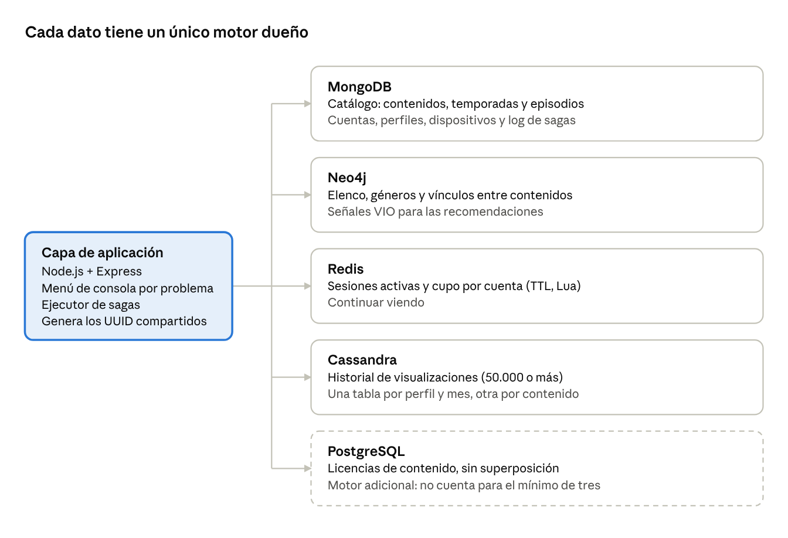

# StreamDB — Matriz de trazabilidad

7 de octubre de 2026 · Santiago Hanine

StreamDB reparte el dominio en cinco motores: cuatro NoSQL (MongoDB, Neo4j, Redis y Cassandra) y PostgreSQL como motor relacional adicional, solo para las licencias de contenido. Cada dato tiene un único motor dueño; si aparece en otro, es una copia deliberada con un responsable de sincronizarla.

## Criterios

- **Patrón de acceso:** cómo se lee y se escribe (por clave, recorrido de grafo, rango temporal, filtros combinados).
- **Volumen y frecuencia:** cuántos registros y cada cuánto se escriben.
- **Consistencia requerida:** fuerte (contratos, cupos de sesión) o eventual (señales para recomendaciones).
- **Identificador compartido:** todo objeto de negocio usa el mismo ID (UUID generado en la capa de aplicación) en todos los motores. Eso permite la trazabilidad del problema 8 y la idempotencia de las sagas.

## Arquitectura



La capa de aplicación es la única que habla con los motores y coordina las escrituras que cruzan más de uno. PostgreSQL aparece con borde punteado porque es el motor relacional opcional.

## Matriz entidad/proceso → motor

Los volúmenes son los que generará el script de carga; el historial es la entidad de mayor volumen que exige el enunciado (50.000 o más registros).

| Entidad / proceso | Cómo se lee | Cómo se escribe | Volumen | Frecuencia | Consistencia | Motor |
| --- | --- | --- | --- | --- | --- | --- |
| Cuenta + Perfiles | Por `idCuenta`, con sus perfiles embebidos | Alta de cuenta, edición de perfil | 1.000 cuentas, 2.500 perfiles | L media, E baja | Fuerte (email único) | **MongoDB** |
| Dispositivo | Por `idDispositivo` | Registro al primer uso | 3.000 | L media, E baja | Fuerte | **MongoDB** |
| Contenido + Temporadas + Episodios | Ficha completa por `idContenido`; filtros combinados por género, actor y plataforma (P7) | Alta por el administrador (P1), retiro (P8) | 500 contenidos, ~4.600 episodios | L muy alta, E baja | Fuerte para `estado` | **MongoDB** |
| PlataformaOrigen, Genero | Embebidos en la ficha y como filtros | Carga inicial | 10 plataformas, 20 géneros | L alta, E muy baja | Fuerte | **MongoDB** |
| Actor + Actuacion | Elenco de un contenido; contenidos de un actor | P1 | 2.000 actores, 6.000 actuaciones | L alta, E baja | Fuerte | **Neo4j** |
| Vínculos entre contenidos (secuela, precuela, mismo universo, similar) | Recorridos de 1 a 3 saltos | P1 | 1.500 relaciones | L alta, E baja | Fuerte | **Neo4j** |
| Señal de consumo (`VIO`) | Recomendaciones del perfil (P5); las veces y la última vista se calculan con `count()` y `max()` | Una relación por visualización terminada, identificada por `idVisualizacion` (P4) | ~20.000 aristas | L media, E media | Eventual | **Neo4j** |
| Sesión activa + cupo por cuenta | Contar sesiones de una cuenta; la sesión de un dispositivo | Abrir o reutilizar (P2), heartbeat (P3), expirar y cerrar (P6). Una sesión por dispositivo | Cientos simultáneas | L y E muy altas | Fuerte y atómica (scripts Lua) | **Redis** |
| Continuar viendo | Un puntero por perfil y contenido; los del perfil ordenados por recencia; los perfiles que tienen un contenido (P8) | Cada pocos segundos (P3), avance de episodio (P4), retiro (P8) | 10.000 punteros | E muy alta | Último valor gana; se reconstruye desde Cassandra si se pierde | **Redis** (con AOF) |
| Historial de visualizaciones | Por perfil y período; por contenido (P8) | Una fila por visualización: se crea en P2 y se actualiza por su clave exacta (upsert) en P3 y P4 | 50.000 o más | E muy alta, L media | Eventual | **Cassandra** |
| Historial de sesiones cerradas | Por cuenta, lo más nuevo primero | Una fila al cerrar cada sesión, con motivo (manual, expirada, cierre remoto) (P6) | Una por sesión | E media, L baja | Eventual (si Cassandra falla, queda pendiente y se reintenta) | **Cassandra** |
| Licencia de contenido | Vigentes por contenido y región; vencidas a una fecha | Alta y renovación, pocas veces | 1.000 | L y E bajas | Fuerte, sin superposición | **PostgreSQL** |
| Log de sagas | Por `idSaga`; pendientes al reiniciar | Un cambio por paso | Uno por operación | E media | Fuerte (documento atómico) | **MongoDB** |

## Modelo relacional: Licencias (PostgreSQL)

La entidad nueva `Licencia` registra el permiso para mostrar un contenido en una región durante un período. Vive en PostgreSQL porque la base debe impedir que un contenido tenga dos licencias superpuestas en la misma región, y ningún motor NoSQL de la cursada lo garantiza sin código propio.

**Cambio en el DER:** se agrega `Licencia`, relacionada 1:N con `Contenido` (un contenido tiene muchas licencias) y 1:N con `PlataformaOrigen` (la plataforma la otorga). El retiro del problema 8 pasa a dispararse cuando vence una licencia.

```sql
CREATE EXTENSION IF NOT EXISTS btree_gist;

CREATE TABLE licencia (
  id_licencia   UUID PRIMARY KEY,
  id_contenido  UUID NOT NULL,          -- mismo ID que en Mongo, Neo4j y Cassandra
  id_plataforma UUID NOT NULL,
  region        CHAR(2) NOT NULL,       -- código de país ISO, ej. 'AR'
  vigencia      DATERANGE NOT NULL,     -- [desde, hasta)
  estado        TEXT NOT NULL DEFAULT 'vigente'
                CHECK (estado IN ('vigente', 'vencida', 'rescindida')),
  -- un contenido no puede tener dos licencias superpuestas en la misma región
  EXCLUDE USING gist (id_contenido WITH =, region WITH =, vigencia WITH &&)
    WHERE (estado <> 'rescindida')
);

-- P8: "vigentes que ya vencieron a una fecha" y "licencias de un contenido"
CREATE INDEX licencia_estado_fin ON licencia (estado, upper(vigencia));
CREATE INDEX licencia_contenido ON licencia (id_contenido);
```

`id_contenido` no tiene clave foránea porque el contenido vive en MongoDB; la capa de aplicación verifica que exista antes de insertar.

**Ejemplo de datos**

| id_licencia | id_contenido | region | vigencia | estado |
| --- | --- | --- | --- | --- |
| `lic-001` | `c-7f3a` (Breaking Bad) | AR | [2025-01-01, 2028-01-01) | vigente |
| `lic-002` | `c-7f3a` (Breaking Bad) | ES | [2024-06-01, 2026-06-01) | vencida |
| `lic-003` | `c-91bd` (Dark) | AR | [2023-03-01, 2026-10-01) | vigente |

**Ejemplo de rechazo:** insertar una licencia de `c-7f3a` en AR para `[2027-01-01, 2029-01-01)` falla con `conflicting key value violates exclusion constraint`, porque se superpone con `lic-001`.

**Regla de retiro (P8):** el catálogo no es regional (ni la cuenta ni el perfil tienen región), así que un contenido se retira cuando **no le queda ninguna licencia que cubra la fecha, en ninguna región**. Si le queda otra (otra región o una renovación), sus licencias vencidas solo se marcan `vencida` y sigue publicado. `lic-003` venció el 2026-10-01 y Dark no tiene otra licencia, así que se retira.

**Comprobado:** insertar una licencia superpuesta en la misma región falla con `conflicting key value violates exclusion constraint "licencia_sin_superposicion"`; la misma fecha en otra región se acepta.

**Consulta que dispara el retiro (P8):**

```sql
SELECT id_licencia, id_contenido, region
FROM licencia
WHERE estado = 'vigente' AND upper(vigencia) <= CURRENT_DATE;
```

## Matriz de trazabilidad de identificadores

Cada fila es un identificador compartido y muestra cómo aparece en cada motor. Una celda vacía significa que ese motor no conoce el objeto. `idContenido` es el único que aparece en los cinco motores, y es el que usa la consulta de trazabilidad del problema 8.

| ID | MongoDB | Neo4j | Redis | Cassandra | PostgreSQL |
| --- | --- | --- | --- | --- | --- |
| `idContenido` | `contenidos._id` | `(:Contenido {id})` | Parte de `cv:{idPerfil}:{idContenido}`; miembro de `continuar:{idPerfil}`; claves `viendo:{idContenido}`, `cv_perfiles:{idContenido}` y `retirado:{idContenido}`; campo de `sesion:{idSesion}` | Columna de `historial_por_perfil`; clave de partición de `historial_por_contenido` | `licencia.id_contenido` |
| `idEpisodio` | `contenidos.temporadas[].episodios[].id` | | En el valor de `cv:{idPerfil}:{idContenido}` y de `sesion:{idSesion}` (en películas, el `idContenido`) | Columna común de ambas tablas de historial (nula en películas) | |
| `idPerfil` | `cuentas.perfiles[].id` | `(:Perfil {id})` | Parte de `cv:{idPerfil}:…` y `continuar:{idPerfil}`; miembro de `cv_perfiles:{idContenido}`; campo de `sesion:{idSesion}` | Clave de partición de `historial_por_perfil`; columna de `sesiones_por_cuenta` | |
| `idCuenta` | `cuentas._id` | | Clave de `cupo:{idCuenta}` (ZSET de sesiones activas); campo de `sesion:{idSesion}` | Clave de partición de `sesiones_por_cuenta` | |
| `idSesion` | En `sagas.datos` (P2) | | `sesion:{idSesion}` (HASH, sin TTL) y `vida:{idSesion}` (TTL); miembro de `cupo:{idCuenta}` y `viendo:{idContenido}`; valor de `disp:{idDispositivo}` | Columna de ambas tablas de historial; clave de `sesiones_por_cuenta` | |
| `idVisualizacion` | En `sagas.datos` (para compensar P2 y P4) | Propiedad de `[:VIO {idVisualizacion}]`, con restricción de unicidad | Campo de `sesion:{idSesion}`, junto con la fecha de inicio | Columna de clustering de ambas tablas de historial | |
| `idDispositivo` | `dispositivos._id` | | Clave `disp:{idDispositivo}` (su sesión activa); campo de `sesion:{idSesion}` | Columna de `sesiones_por_cuenta` | |
| `idActor` | En `contenidos.elenco[].idActor` (copia para P7) | `(:Actor {id})` | | | |
| `idLicencia` | En `contenidos.retiro.idLicencia` (motivo del retiro) | | | | `licencia.id_licencia` |
| `idSaga` | `sagas._id`; `contenidos.retiro.idSaga` | En `retiradoPor` del nodo (P8) | | | |

Todos los IDs son UUID generados en la capa de aplicación antes de escribir. Como el ID ya existe cuando se reintenta un paso, las escrituras son idempotentes: `upsert` o `updateOne` condicionado al estado en Mongo, `MERGE` en Neo4j, `SET`/`HSET` en Redis, `INSERT`/`UPDATE` sobre la misma clave en Cassandra y `UPDATE` condicionado al estado en PostgreSQL.

## Matriz problema → motores

Los ocho problemas usan al menos dos motores. En las escrituras, el orden va de lo menos visible a lo más visible: el paso que "publica" el cambio para el usuario es siempre el último, así una falla nunca deja algo visible a medias.

| Problema | Tipo | Motores | Orden de lecturas y escrituras | Compensación si falla | ID que los une | Código |
| --- | --- | --- | --- | --- | --- | --- |
| P1 Alta de serie | Escritura + rollback | Mongo, Neo4j | 1. Mongo `ficha` con `estado: borrador` → 2. Mongo `episodios` → 3. Neo4j `nodo` (contenido y géneros) → 4. Neo4j `elenco` → 5. Neo4j `vinculos` → 6. `publicar`: Neo4j y por último Mongo `estado: publicado` | En orden inverso: volver a `borrador`; borrar vínculos, elenco y nodo en Neo4j; quitar los episodios y borrar el borrador en Mongo | `idContenido` | `POST /contenidos/series` · `p1-alta-serie.js` |
| P2 Inicio de reproducción | Escritura + rollback | Mongo (lectura), Redis, Cassandra | 1. Mongo: perfil, `limiteSesiones`, contenido publicado y apto; Redis: "continuar viendo" para retomar → 2. Redis `reservar_cupo` (Lua atómico): si el dispositivo ya tiene una sesión activa de la cuenta, **la reutiliza** (compare-and-set, no ocupa otro lugar); si no, verifica `ZCARD < limite` y crea `sesion:{id}`, `vida:{id}` (TTL) y `disp:{idDispositivo}`. `idVisualizacion` y la fecha de inicio se generan **una sola vez** → 3. Cassandra `registrar_inicio`: fila nueva de la visualización, con el segundo desde el que retoma | Sesión nueva: `ZREM` del cupo y borrar sesión, vida y dispositivo. Sesión reutilizada: restaurarla como estaba (no se libera). Cassandra: borrar la fila por su clave | `idSesion`, `idCuenta`, `idVisualizacion` | `POST /reproducciones` · `p2-inicio-reproduccion-sesiones.js` |
| P3 Progreso | Escritura | Redis, Cassandra | 1. Redis, en cada reporte (Lua atómico): `cv:{perfil}:{contenido}` con la unidad y el segundo exacto, índices `continuar:{perfil}` y `cv_perfiles:{contenido}`, y heartbeat (renueva `vida:`, `disp:` y los scores de `cupo:` y `viendo:`). Rechaza si la sesión expiró (410), si la visualización ya terminó (P4, 409) o si el contenido se retiró (P8, 410) → 2. Cassandra: **upsert de la fila de la visualización en curso** (misma clave `(id_perfil, mes, fecha, id_visualizacion)`) cada 6 reportes **y al pausar o cerrar** | No aplica: es un upsert de valor absoluto. Si falla Cassandra, responde `checkpoint: fallido` y el siguiente checkpoint lo corrige | `idVisualizacion` (junto con `idPerfil` y el id de unidad) | `POST /reproducciones/:idSesion/progreso`; `GET /perfiles/:id/continuar-viendo` (Redis, o reconstruido desde Cassandra); `GET /perfiles/:id/historial?desde&hasta` · `p3-progreso.js` |
| P4 Fin de episodio | Escritura + rollback | Mongo (lectura), Cassandra, Redis, Neo4j | Mongo: duración y episodio siguiente → 1. Cassandra `marcar_finalizado` sobre la fila de la visualización (guarda antes los valores previos) → 2. Redis `continuar_viendo` (Lua): lee el `cv` anterior y lo mueve al siguiente episodio en el segundo 0, o lo quita si no hay siguiente; marca la visualización como terminada en la sesión → 3. Neo4j `senal_vio`: `MERGE (p)-[r:VIO {idVisualizacion: $id}]->(c)` | Borrar la `VIO` por `idVisualizacion`; restaurar el `cv` anterior (guardado en la saga); restaurar la fila de Cassandra. Todas idempotentes. Reintentar un fin ya registrado devuelve `yaRegistrado` | `idVisualizacion`, `idPerfil`, `idEpisodio` | `POST /reproducciones/:idSesion/fin` · `p4-fin-episodio.js` |
| P5 Recomendaciones | Consulta | Mongo, Redis, Neo4j | 1. Mongo: clasificación del perfil → 2. Redis: lo que está viendo (`continuar:{perfil}`), que cuenta como consumo reciente y no se recomienda; Neo4j: últimos `VIO` → 3. Neo4j: recorrido por secuela/precuela, mismo universo, similar, elenco y género, con pesos y recencia, excluyendo lo visto, lo no publicado y lo no apto; el camino de más peso es el "porque viste X" → 4. Mongo: fichas, revalidando publicado y apto (fuente de verdad). Sin historial: lo más visto | No aplica | `idPerfil`, `idContenido` | `GET /perfiles/:id/recomendaciones` · `p5-recomendaciones.js` |
| P6 Expiración y cierre | Escritura | Redis, Cassandra | **Expiración**, con tres garantías: (a) listener de keyspace notifications sobre la expiración de `vida:{id}`; (b) barrido cada 30 s y al arrancar; (c) el Lua de P2 libera el cupo vencido al reservar. **Cierre remoto**: un Lua cierra todas las sesiones de la cuenta y vacía `cupo:{cuenta}` en la misma operación. **Cierre manual**: una sesión. En los tres: se registra el cierre en `sesiones_por_cuenta` y el último segundo de la visualización en curso | No aplica (idempotente). Si Cassandra falla, el cierre en Redis ya está hecho y el registro queda en `cierres_pendientes`, que el barrido reintenta | `idCuenta`, `idSesion` | `POST /cuentas/:id/cerrar-sesiones`; `DELETE /reproducciones/:idSesion`; `GET /cuentas/:id/sesiones` · `p6-expiracion-cierre-sesiones.js` |
| P7 Exploración | Consulta | Mongo, Redis, Neo4j | 1. Mongo: filtros combinados (solo publicado y, con perfil, apto para su edad) y cantidad de episodios → 2. En paralelo: Neo4j, contenidos vinculados de cada resultado; Redis, si hay `idPerfil`, el `cv:{idPerfil}:{idContenido}` de cada resultado (episodio y segundo exacto) | No aplica | `idContenido`, `idPerfil` | `GET /contenidos?genero&idActor&idPlataforma&idPerfil` · `p7-exploracion.js` |
| P8 Retiro y trazabilidad | Escritura + rollback | PostgreSQL, Redis, Neo4j, Mongo (Cassandra solo en la trazabilidad) | Postgres (lectura): que no quede licencia vigente y cuáles vencieron → 1. Redis `continuar_viendo` (Lua): guarda y borra los `cv` de cada perfil (vía `cv_perfiles:`) y marca `retirado:{id}` para que P3 no los recree → 2. Neo4j `marcar_nodo`: `estado = retirado`, `retiradoPor = idSaga` → 3. Mongo `retirar_ficha`: `estado: retirado` y `retiro` → 4. Postgres `vencer_licencias`, último: si algo falla antes, la licencia sigue vigente y el próximo proceso de vencimientos lo reintenta. Cassandra no se toca: el historial se conserva | En orden inverso: licencias vigentes, ficha publicada, nodo desmarcado (solo si lo marcó esta saga), `cv` restaurados con su puntaje y marca borrada | `idContenido`, `idLicencia`, `idSaga` | `POST /contenidos/:id/retiro`; `POST /licencias/procesar-vencimientos?fecha`; `GET /contenidos/:id/trazabilidad` · `p8-retiro-trazabilidad.js` |

Todos los endpoints van con el prefijo `/api/v1`. Las escrituras con rollback aceptan `?fallarEn=<paso>` para provocar la falla en ese paso.

## Ejemplo completo: *Dark* en los cinco motores

La serie *Dark* (`c-91bd`) y el perfil "Sofi" (`p-12ab`, de la cuenta `a-55e0`), que está viendo el episodio 2 de la temporada 1. Los IDs están abreviados para que se lean; en el sistema son UUID completos.

**MongoDB: ficha del contenido** (colección `contenidos`)

```json
{
  "_id": "c-91bd",
  "titulo": "Dark",
  "tipo": "serie",
  "estado": "publicado",
  "anioEstreno": 2017,
  "clasificacionEdad": 16,
  "plataforma": { "id": "pl-04", "nombre": "Netflix", "paisOrigen": "DE" },
  "generos": ["Ciencia ficción", "Misterio"],
  "elenco": [{ "idActor": "ac-301", "nombre": "Louis Hofmann", "personaje": "Jonas Kahnwald" }],
  "temporadas": [
    { "numero": 1, "episodios": [
      { "id": "e-91bd-1-1", "numero": 1, "titulo": "Secretos", "duracionSeg": 3060 },
      { "id": "e-91bd-1-2", "numero": 2, "titulo": "Mentiras", "duracionSeg": 2640 }
    ] }
  ]
}
```

**MongoDB: cuenta con perfiles** (colección `cuentas`)

```json
{
  "_id": "a-55e0",
  "email": "titular@ejemplo.com",
  "estado": "activa",
  "limiteSesiones": 2,
  "perfiles": [{ "id": "p-12ab", "nombre": "Sofi", "idioma": "es", "clasificacionEdad": 18 }]
}
```

**Neo4j: elenco, géneros, vínculos y señales de consumo**

```cypher
(:Contenido {id: 'c-91bd', titulo: 'Dark', clasificacionEdad: 16})
(:Actor {id: 'ac-301', nombre: 'Louis Hofmann'})-[:ACTUA_EN {personaje: 'Jonas Kahnwald'}]->(:Contenido {id: 'c-91bd'})
(:Contenido {id: 'c-91bd'})-[:DE_GENERO]->(:Genero {nombre: 'Ciencia ficción'})
(:Contenido {id: 'c-1899'})-[:RELACIONADO {tipo: 'mismo_universo'}]->(:Contenido {id: 'c-91bd'})
(:Perfil {id: 'p-12ab'})-[:VIO {idVisualizacion: 'v-0a17', fecha: datetime('2026-09-28T22:10Z')}]->(:Contenido {id: 'c-44f1'})
(:Perfil {id: 'p-12ab'})-[:VIO {idVisualizacion: 'v-3e92', fecha: datetime('2026-10-02T21:30Z')}]->(:Contenido {id: 'c-44f1'})
```

Hay una relación `VIO` por visualización terminada, y la cantidad de veces no se guarda: se calcula al consultar. Así, reintentar el paso de P4 o su compensación no suma ni resta de más.

```cypher
// unicidad de la señal (Neo4j 5.26 Community la soporta; también crea el índice que usa la compensación)
CREATE CONSTRAINT vio_visualizacion IF NOT EXISTS FOR ()-[r:VIO]-() REQUIRE r.idVisualizacion IS UNIQUE;

// P4, acción y compensación (las dos idempotentes)
MERGE (p)-[r:VIO {idVisualizacion: $id}]->(c) ON CREATE SET r.fecha = $fecha
MATCH ()-[r:VIO {idVisualizacion: $id}]->() DELETE r

// veces y última vista, calculadas (en una serie, count(DISTINCT c) cuenta el contenido una sola vez)
MATCH (:Perfil {id: $perfil})-[v:VIO]->(c) RETURN c, count(v) AS veces, max(v.fecha) AS ultima
```

**Redis: sesión, cupo y "continuar viendo"**

```text
ZSET  cupo:a-55e0          { s-7781 : 1791417600 }            # sesiones activas, score = última actividad
HASH  sesion:s-7781        idCuenta=a-55e0 idPerfil=p-12ab idDispositivo=d-3310 idContenido=c-91bd
                           idEpisodio=e-91bd-1-2 idVisualizacion=v-5d20 fechaInicio=2026-10-07T21:40Z
                           inicioSesion=2026-10-07T21:02Z ultimaActividad=… posicionSeg=1325   # sin TTL
STRING vida:s-7781         "1"                                 TTL 120 s   # mientras exista, la sesión está activa
STRING disp:d-3310         s-7781                              TTL 120 s   # una sesión por dispositivo
ZSET  viendo:c-91bd        { s-7781 : 1791417600 }            # sesiones mirando ahora (P8)
HASH  cv:p-12ab:c-91bd     idEpisodio=e-91bd-1-2 segundo=1325 actualizado=2026-10-07T21:52Z
ZSET  continuar:p-12ab     { c-91bd : 1791418320 }            # "continuar viendo" del perfil, por recencia
SET   cv_perfiles:c-91bd   { p-12ab }                          # quién tiene cv de Dark (para borrarlos en P8)
```

La sesión está separada en dos claves a propósito: cuando `vida:` expira, los datos de `sesion:` siguen ahí, y P6 sabe qué cupo liberar y qué registrar en Cassandra. Si P8 retira un contenido, además queda `STRING retirado:{idContenido}` para que P3 deje de aceptar progreso.

**Cassandra: historial de visualizaciones** (dos tablas, una por consulta)

```sql
CREATE TABLE historial_por_perfil (
  id_perfil uuid, mes text, fecha timestamp, id_visualizacion uuid,
  id_contenido uuid, id_episodio uuid,      -- id_episodio: nulo en películas
  id_sesion uuid, fecha_fin timestamp, posicion_seg int, finalizado boolean,
  PRIMARY KEY ((id_perfil, mes), fecha, id_visualizacion)
) WITH CLUSTERING ORDER BY (fecha DESC, id_visualizacion ASC);

CREATE TABLE historial_por_contenido (
  id_contenido uuid, fecha timestamp, id_visualizacion uuid,
  id_perfil uuid, id_episodio uuid, id_sesion uuid,
  fecha_fin timestamp, posicion_seg int, finalizado boolean,
  PRIMARY KEY ((id_contenido), fecha, id_visualizacion)
) WITH CLUSTERING ORDER BY (fecha DESC, id_visualizacion ASC);
```

Reglas de la clave:

- `fecha` es el **momento en que empezó la visualización** y no cambia mientras dura; `mes` se calcula a partir de ella. Una visualización que cruza el cambio de mes queda en la partición del mes en que empezó.
- **P2** crea la fila; **P3** (cada checkpoint) y **P4** (`finalizado`) hacen upsert sobre la misma clave exacta. Reintentar cualquier paso no duplica filas.
- Cada escritura va a las dos tablas en un `BATCH` *logged*: si una se aplica, Cassandra garantiza que la otra también.
- Con `id_visualizacion` en la clave, `id_episodio` es una columna común y puede ser nula en películas.
- Si Redis se pierde, "continuar viendo" se reconstruye desde la partición `(id_perfil, mes actual)` (y si está vacía, la del mes anterior): por cada contenido vale su última visualización, con la misma regla que P4. Si quedó a medias, se retoma en ese punto; si terminó, en el episodio siguiente desde 0; si no hay siguiente (o era una película), no vuelve. El seed de Redis aplica la misma regla sobre el historial completo, así los dos motores arrancan coherentes.
- `historial_por_contenido` particiona solo por contenido. Con 50.000 filas no es un problema; particionar por `(id_contenido, mes)` queda como mejora opcional para títulos muy vistos.

El historial de sesiones (P6) va en su propia tabla, una fila por sesión cerrada:

```sql
CREATE TABLE sesiones_por_cuenta (
  id_cuenta uuid, fecha_inicio timestamp, id_sesion uuid,
  id_perfil uuid, id_dispositivo uuid, fecha_fin timestamp, motivo_cierre text,  -- manual | expirada | cierre_remoto
  PRIMARY KEY ((id_cuenta), fecha_inicio, id_sesion)
) WITH CLUSTERING ORDER BY (fecha_inicio DESC, id_sesion ASC);
```

En una sesión expirada, `fecha_fin` es su última actividad, no el momento en que se detectó.

Se probó en Cassandra 4.1 (keyspace descartable): tres checkpoints y dos `finalizado = true` sobre una visualización que empieza el 31/10 y termina el 1/11 dejan una sola fila, en la partición de octubre.

| id_perfil | mes | fecha | id_visualizacion | id_contenido | id_episodio | fecha_fin | posicion_seg | finalizado |
| --- | --- | --- | --- | --- | --- | --- | --- | --- |
| p-12ab | 2026-10 | 2026-10-07 21:40 | v-5d20 | c-91bd | e-91bd-1-2 | 2026-10-07 22:02 | 1325 | false |
| p-12ab | 2026-10 | 2026-10-07 21:02 | v-41c8 | c-91bd | e-91bd-1-1 | 2026-10-07 21:53 | 3060 | true |

**PostgreSQL: licencia**

| id_licencia | id_contenido | region | vigencia | estado |
| --- | --- | --- | --- | --- |
| lic-003 | c-91bd | AR | [2023-03-01, 2026-10-01) | vigente |

## Consulta de trazabilidad (P8)

Con un solo `idContenido`, `GET /api/v1/contenidos/:id/trazabilidad` (`trazabilidad()` en `p8-retiro-trazabilidad.js`) consulta los cinco motores en paralelo y une los resultados. Si un motor no responde, devuelve los demás e indica cuál falló. Cada dato se lee de su motor dueño, no de una copia, como exige la sección 6 del enunciado.

| Dato pedido | Motor | Lectura |
| --- | --- | --- |
| Ficha | MongoDB | `contenidos.findOne({ _id })` |
| Vínculos, elenco y señales `VIO` | Neo4j | `MATCH (c:Contenido {id: $id})-[r:RELACIONADO]-(o) …` (secuela o precuela según el sentido de la relación) |
| Perfiles mirando ahora | Redis | Sesiones de `viendo:{idContenido}` cuya `vida:` sigue activa; se cuentan los perfiles distintos |
| Historial de visualizaciones | Cassandra | `SELECT … FROM historial_por_contenido WHERE id_contenido = ? LIMIT ?` y `count(*)` de la partición |
| Licencias | PostgreSQL | `SELECT * FROM licencia WHERE id_contenido = $1` |

Resultado para `c-91bd`:

```json
{
  "idContenido": "c-91bd",
  "ficha": { "titulo": "Dark", "tipo": "serie", "estado": "publicado", "episodios": 26, "origen": "MongoDB" },
  "vinculos": { "estado": "publicado", "vinculos": [{ "idContenido": "c-1899", "titulo": "1899", "relacion": "mismo_universo" }],
                "elenco": 7, "senalesVio": 40, "origen": "Neo4j" },
  "viendoAhora": { "perfiles": 1, "sesiones": 1, "origen": "Redis" },
  "historial": { "total": 412, "ultimas": [{ "idPerfil": "p-12ab", "idEpisodio": "e-91bd-1-2", "fechaInicio": "2026-10-07T21:40Z" }], "origen": "Cassandra" },
  "licencias": { "licencias": [{ "idLicencia": "lic-003", "region": "AR", "hasta": "2026-10-01", "estado": "vigente" }], "origen": "PostgreSQL" }
}
```

Los números de este JSON son ilustrativos; la estructura es la que devuelve el endpoint.

## Desnormalizaciones y responsable de sincronizarlas

| Dato duplicado | Dueño | Copia en | Para qué | Quién lo sincroniza |
| --- | --- | --- | --- | --- |
| Elenco (nombre y personaje) | Neo4j | Mongo `contenidos.elenco` | Mostrar y filtrar por actor en P7 sin cruzar motores | Saga P1 (se escribe en ambos en el mismo alta) |
| `clasificacionEdad` y `estado` del contenido | Mongo | Propiedades del nodo `:Contenido` en Neo4j | Filtrar recomendaciones dentro del recorrido (P5) | Sagas P1 y P8 |
| Géneros | Mongo (nombres en la ficha) | Nodos `:Genero` en Neo4j | Recorridos "mismo género" | Saga P1 |
| Sesiones mirando un contenido | Redis `sesion:{id}` | Redis `viendo:{idContenido}` | Saber quién lo mira ahora sin recorrer todas las sesiones (P8) | Scripts Lua de P2, P3 y P6 |
| Sesión activa de un dispositivo | Redis `sesion:{id}` | Redis `disp:{idDispositivo}` | Reutilizar la sesión del dispositivo (P2) | Lua de P2 (crea), P3 (renueva TTL) y P6 (borra) |
| Contenidos con "continuar viendo" de un perfil | Redis `cv:{perfil}:{contenido}` | Redis `continuar:{perfil}` | Listarlos por recencia sin `SCAN` (P3, P5) | Lua de P3 y P4; Lua de P8 al retirar |
| Perfiles con "continuar viendo" de un contenido | Redis `cv:{perfil}:{contenido}` | Redis `cv_perfiles:{contenido}` | Borrarlos todos al retirar el contenido (P8) | Lua de P3 y P4; Lua de P8 al retirar |
| Contenido retirado | Mongo `contenidos.estado` | Redis `retirado:{contenido}` | Que P3 rechace progreso sin consultar Mongo en cada reporte | Saga P8 (paso de Redis) |
| Estado del contenido vs. sus licencias | Mongo `estado` | PostgreSQL `licencia.estado` | Retirar por fin de licencia | Saga P8 (Mongo y Postgres en la misma saga) |
| Historial | Cassandra `historial_por_perfil` | Cassandra `historial_por_contenido` | Consultar por contenido (P8) | Un `BATCH` *logged* en cada escritura (inicio en P2, checkpoints en P3, fin en P4), con la misma clave en las dos tablas |

## Historial de cambios

| Fecha | Cambio | Motivo |
| --- | --- | --- |
| 2026-10-12 | **A1.** Historial en Cassandra: se agrega `id_visualizacion` a la clave y `fecha` pasa a ser la fecha de inicio, fija | Sin un id, cada checkpoint creaba una fila nueva y P4 no podía identificar la fila a marcar; una visualización que cruzaba de mes cambiaba de partición |
| 2026-10-12 | **A2.** Señal `VIO` en Neo4j: una relación por visualización, identificada por `idVisualizacion`; el contador `veces` se calcula con `count()` | Un contador incrementado no es idempotente: reintentar el paso o la compensación de P4 sumaba o restaba de más |
| 2026-10-12 | **A3.** P3 se redacta como upsert de la fila de la visualización en curso, también al pausar o cerrar | "Evento de progreso" se podía leer como una fila nueva por checkpoint; sin el checkpoint al cerrar se perdían los últimos segundos |
| 2026-10-17 | **B1.** Una sesión por dispositivo: P2 reutiliza la sesión activa del dispositivo (`disp:{idDispositivo}`) en vez de ocupar otro lugar | El cupo limita dispositivos simultáneos; pasar al episodio siguiente en el mismo dispositivo no debe ocupar otro lugar ni dejar que otro dispositivo "robe" el lugar entre episodios |
| 2026-10-17 | **B2.** La sesión se separa en `sesion:{id}` (datos, sin TTL) y `vida:{id}` (TTL) | Al expirar, P6 necesita los datos para liberar el cupo, limpiar "viendo ahora" y registrar el cierre en Cassandra |
| 2026-10-17 | **B3.** P6: listener de expiraciones + barrido de respaldo + tabla `sesiones_por_cuenta` + lista `cierres_pendientes` | Las sesiones expiran solas aunque el listener se caiga; el historial de sesiones no se pierde si Cassandra está caída |
| 2026-10-17 | **B4.** Índices `continuar:{perfil}` y `cv_perfiles:{contenido}`, y marca `retirado:{contenido}` | Listar "continuar viendo" y borrarlo en P8 sin `SCAN`; que una sesión abierta no recree el `cv` de un contenido retirado |
| 2026-10-17 | **B5.** Regla de retiro: sin ninguna licencia vigente, en ninguna región | El catálogo no es regional; si queda otra licencia, solo se marcan las vencidas |
| 2026-10-17 | **B6.** Timeouts de 5 s en Neo4j, Mongo y PostgreSQL | Con un motor caído, un paso tardaba hasta 63 s en fallar; cuanto antes falla, antes se compensa la saga |
